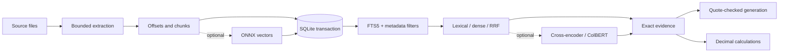

<div align="center">

# RAG Pipeline

**Local, evidence-first retrieval that cites the exact source text.**

Financial reports, account records, legal contracts, biomedical abstracts, software docs and books.
One SQLite file. One transaction. One required dependency.

[](https://github.com/pxnz3r/rag-pipeline/actions/workflows/ci.yml)


[Quickstart](#quickstart) · [Features](#features) · [How it works](#how-it-works) · [Docs](#documentation) · [Benchmarks](docs/TESTING.md)

</div>

---

## Why

Most RAG stacks split state across a vector DB, a document store and a cache, then let a model paraphrase whatever comes back. This pipeline keeps original text, metadata, full-text search and optional vectors in **one SQLite transaction**, and answers with **exact evidence and character offsets**. Generation is optional and must quote sources verbatim. Arithmetic runs as explicit, source-bound `Decimal` operations, never model-generated code.

## Features

| | |
|---|---|
| **Transactional ingest** | Text, metadata, FTS5 and vectors update together. A failed ingest rolls back everything; a missing source directory never silently deletes the corpus. |
| **Exact evidence** | Hits carry original text, page locators and character offsets. Optional generation must return verifiable quotes. |
| **Metadata filters** | Sidecar `*.meta.json` fields (company, year, jurisdiction, ...) filter *before* lexical and dense scoring. |
| **Hybrid search** | BM25 lexical by default; opt-in local ONNX dense vectors, RRF fusion, cross-encoder or ColBERT reranking. |
| **Heading context** | `--contextual` carries Markdown heading hierarchies into indexing and enables document navigation. |
| **Grounded numbers** | `reason` runs source-bound quantitative programs with execution traces. |
| **No hidden models** | No model or vendor is selected by default. No PyTorch, pickle caches or remote model code. |
| **Many formats** | PDF, TXT, Markdown, CSV, JSON/JSONL, Python and SQL. |

## Quickstart

```bash
pip install -e .
mkdir -p data          # add PDFs, TXT/Markdown, CSV, JSON/JSONL, Python or SQL files
rag-pipeline ingest data
rag-pipeline search "revenue" --filter company=Acme --filter year=2024
rag-pipeline ask "revenue" --filter company=Acme --filter year=2024
```

Attach metadata by putting `report.pdf.meta.json` beside `report.pdf`:

```json
{"company": "Acme", "year": 2024, "kind": "annual_report", "jurisdiction": "NY"}
```

From Python:

```python
from rag_pipeline import Index, answer

with Index("processed_data/index.sqlite") as index:
    result = answer(index, "What was revenue?", filters={"company": "Acme", "year": "2024"})
```

## Semantic search and reranking

Optional, local, and explicit. Install the `models` extra and name the adapter you want:

```bash
pip install -e '.[models]'

# Dense + hybrid search with MiniLM
rag-pipeline --dense --embedding rag_pipeline.embeddings:MiniLM ingest data
rag-pipeline --dense --embedding rag_pipeline.embeddings:MiniLM search "How much did sales increase?" --mode hybrid

# E5 encoder with heading context, in a separate index
rag-pipeline --index processed_data/e5.sqlite --dense --embedding rag_pipeline.embeddings:E5 ingest data --contextual

# Cross-encoder reranking
rag-pipeline --dense --embedding rag_pipeline.embeddings:MiniLM \
  --rerank --reranker rag_pipeline.embeddings:CrossEncoder \
  search "Which obligations survive termination?" --mode hybrid --filter jurisdiction=NY

# Token-level ColBERT reranking (prepare once, then search)
rag-pipeline --reranker rag_pipeline.embeddings:ColBERT prepare-reranker
rag-pipeline --rerank --reranker rag_pipeline.embeddings:ColBERT search "..."
```

Model assets are pinned ONNX files and download on first use. Built-in retrieval stays on your machine; `--embedding-server` and `ask --generate` only call servers you configure. See [configuration](docs/CONFIGURATION.md).

## How it works



Details in [architecture](docs/ARCHITECTURE.md).

## Heading context and navigation

`ingest --contextual` carries extractive Markdown heading hierarchies from `.md`/`.txt` sources into lexical and dense indexing. Results expose `context` separately; cited `text` and offsets always stay original. It's opt-in and adds no hosted-model cost. Search also distinguishes `C++`, `C#` and `snake_case` symbols. See [navigation](docs/NAVIGATION.md).

## Numerical reasoning

`reason --program-format expression` with a configured generator answers source-bound quantitative questions. `--route auto` reads complete scoped context when it fits the evidence budget, then falls back to retrieval under that scope. See [reasoning and QA protocol](docs/REASONING.md).

## Benchmarks

Measured on independent FinQA row judgments, CUAD legal character spans, the full BEIR SciFact test set, domain regression canaries and account/vector scale checks. See [results and reproduction](docs/TESTING.md) and [research notes](docs/RESEARCH.md).

> These are transparent subsets, not proof of production accuracy or a state-of-the-art claim. Citation validation proves quote provenance, not semantic entailment. Ambiguous scope, wrong units, OCR and unsupported questions still need review.

## Documentation

| Doc | What's in it |
|---|---|
| [CLI](docs/CLI.md) | Every command and flag |
| [Python API](docs/API.md) | `Index`, `answer`, `calculate`, `reason`, `Navigation` |
| [Configuration](docs/CONFIGURATION.md) | Model servers, ONNX graphs, factories, migration |
| [Architecture](docs/ARCHITECTURE.md) | Storage, transactions, retrieval flow |
| [Navigation](docs/NAVIGATION.md) | Heading trees, scoped sessions, model examples |
| [Reasoning](docs/REASONING.md) | Execution traces, arithmetic verification limits |
| [Operations](docs/OPERATIONS.md) | Upgrades, reindexing, backups |
| [Testing](docs/TESTING.md) | Benchmarks and how to reproduce them |
| [Retrieval landscape](docs/RETRIEVAL-LANDSCAPE.md) | Paper and OSS architecture review |
| [Changelog](CHANGELOG.md) | Release notes |

## Upgrading

- **0.6** adds grounded numerical programs, compact formulas and controlled real-generation QA comparisons.
- **0.5** requires explicit model configuration and stages inference before atomic publication. See [configuration migration](docs/CONFIGURATION.md).
- **0.4** upgrades 0.3 SQLite indexes transactionally on first open, preserving sources and vectors. Back up first; 0.3 can't read the upgraded schema.
- **0.2** users must reindex original files into SQLite and keep old stores for rollback.

Enabling heading context or changing the encoder rebuilds the corpus on the next ingest. See [operations](docs/OPERATIONS.md) and [security](SECURITY.md). The notebook is a small optional interface over this API.

## Contributing

See [CONTRIBUTING](CONTRIBUTING.md), [AGENTS.md](AGENTS.md) for coding agents, [code of conduct](CODE_OF_CONDUCT.md) and [support](SUPPORT.md). CI runs lint, a dependency audit and tests with read-only permissions.

## License

MIT. External benchmark sources keep their own attribution and licenses.
